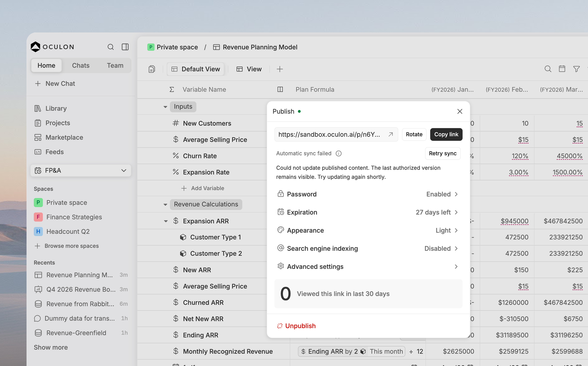

Publishing creates a controlled external way for people to return to a live result without working inside the full planning surface every day.

<Frame caption="Publish settings">
  
</Frame>

## Availability

Publishing is available only when publishing features are enabled for your workspace. If you do not see publish controls in Share, the feature is not available in your environment.

## When to publish

Publish when the recipient needs:

- a live surface they can return to
- a controlled shared view of the current result
- less day-to-day work inside the full model

Prefer publishing over exports when the audience needs current data and repeat access.

## Protect context

A published result can still lose meaning without framing. Confirm the active scenario, filters, and time range before you share the link.

Publishing does not replace item permissions inside the workspace. Recheck source access and sensitive content before you publish.

## Related pages

- [Exports](/concepts/workspace-and-collaboration/sharing-and-permissions/exports)
- [Sharing and permissions](/concepts/workspace-and-collaboration/sharing-and-permissions)
- [Sharing boards](/concepts/analysis-and-reporting/boards/sharing-boards)
