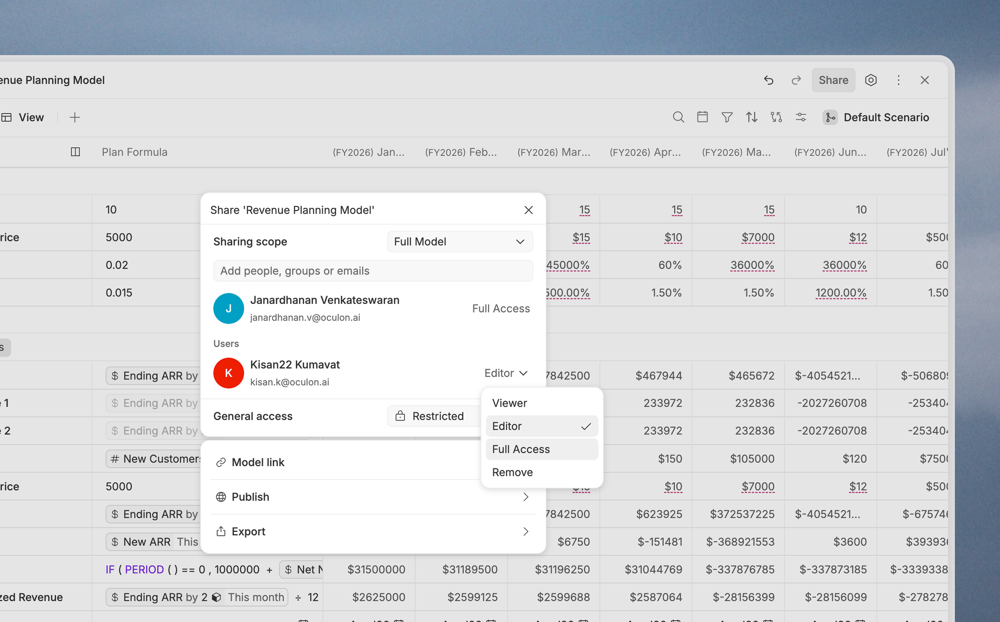

Roles and permissions work together in Oculon, but they do different jobs.

## Two layers of access

| Layer | What it controls |
| :--- | :--- |
| **Workspace membership** | Who can enter the workspace at all |
| **Item-level permissions** | What a person can do on a specific model, board, view, Transactions dataset, or other resource |

Space membership and sharing decide who can discover or open content inside the workspace. Two people can sit in the same workspace or Space and still have different access to the same planning asset.

For workspace join and discovery concepts, see [Workspace access and visibility](/concepts/workspace-and-collaboration/workspace-access-and-visibility). For invites and groups, see [Users, guests and invitations](/concepts/settings-and-administration/users-guests-and-invitations) and [Roles and access](/concepts/settings-and-administration/roles-and-access).

## Item-level access model

Oculon item access commonly uses:

| Access level | What it means |
| :--- | :--- |
| **View** | Read-only access. Open what is shared and use what is already exposed. |
| **Edit** | Change inputs or content without taking over permission management. |
| **Full Access** | Structural changes, sharing, and permission settings on that item. |
| **No Access** | Explicitly remove access. |

<Frame caption="Choose an access level when sharing">
  
</Frame>

## How this applies to models

- **View:** Open the model and review visible data
- **Edit:** Change inputs and create draft changes
- **Full Access:** Manage structure, formulas, sharing, and moves

## How this applies to boards

- **View:** Open the board and use what is already exposed
- **Edit:** Change layout, blocks, and local filters
- **Full Access:** Manage permission settings and broader board governance

Boards do not raise source permissions on their own. If underlying sources are restricted, the audience may still see limited results. See [Sharing and permissions](/concepts/workspace-and-collaboration/sharing-and-permissions).

## How this applies to views

- **View:** Open the saved slice and review exposed data
- **Edit:** Work within the visible slice when editing is allowed
- **Full Access:** Change the saved view definition when that control is available

A view can narrow what someone sees. It does not widen access to the underlying source. Dedicated **Share View** is not generally available yet; share the underlying model or Transactions resource, or put the view on a [board](/concepts/analysis-and-reporting/boards).

## Keep governance and access aligned

Keep the number of people with **Full Access** small. Prefer group-based sharing where it fits. Review [permission inheritance](/concepts/workspace-and-collaboration/sharing-and-permissions/permission-inheritance) whenever content moves between Spaces or shared areas.

## Related pages

- [Sharing and permissions](/concepts/workspace-and-collaboration/sharing-and-permissions)
- [Permission inheritance](/concepts/workspace-and-collaboration/sharing-and-permissions/permission-inheritance)
- [Workspace access and visibility](/concepts/workspace-and-collaboration/workspace-access-and-visibility)
- [Roles and access](/concepts/settings-and-administration/roles-and-access)
