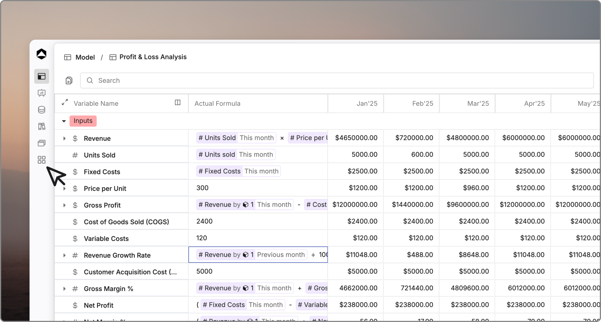
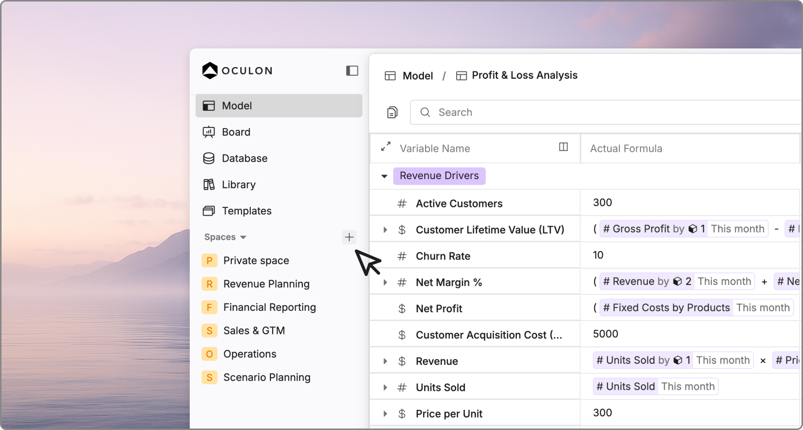
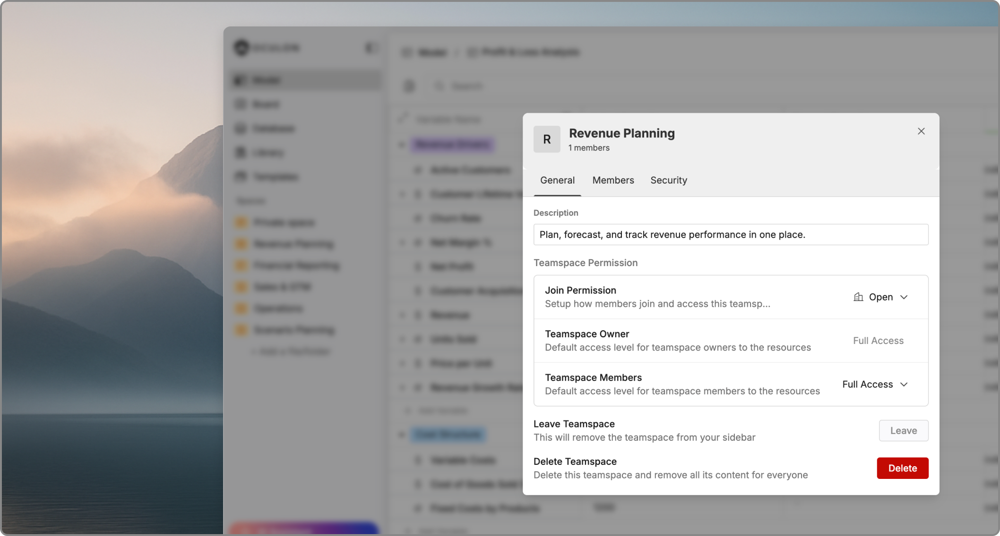

As your workspace grows, structure becomes critical. In the product sidebar, organization lives under **Spaces**. Shared team areas are created as teamspaces. Every user also has a **Private Space** for personal work that is not shared with others.

## Product terminology

| Term | Where you see it | Meaning |
| :--- | :--- | :--- |
| **Spaces** | Sidebar | Collection of private and shared spaces |
| **Teamspace** | Create dialog (**Create New Teamspace**), settings | Shared team area for models, boards, and Transactions |
| **Private Space** | Sidebar / personal space | Personal work area that is not shared |

This page uses those product labels. Older docs often said “Teamspaces” as the umbrella term.

## Accessing Spaces

<Frame caption="Spaces in the sidebar">
  
</Frame>

You can open Spaces from:

- the left navigation under **Spaces**
- related workspace / space switchers in the profile menu

## Why Spaces matter

Spaces help you:

- separate planning areas (for example Finance, RevOps, Sales)
- control access to sensitive models
- avoid clutter and duplicate work
- create a clear ownership structure

Typical shared teamspace setup:

- **Finance** — budgeting, forecasting, actuals
- **Revenue / GTM** — pipeline and growth models
- **Executive** — dashboards and reporting
- **Scenario planning** — what-if work

## Creating a teamspace

<Frame caption="Create a teamspace">
  
</Frame>

1. Click **+** next to **Spaces**.
2. Enter a **name** and optional **description**.
3. Choose **Permission**:
   - **Open** — anyone can join without an invitation
   - **Closed** — people can see the teamspace and request to join; joining needs approval
4. Create the teamspace.

You can also create folders inside a teamspace to organize content further.

## Managing a teamspace

Open a teamspace and use the more options menu to reach settings. Settings commonly include:

- **General** — name, description, join permission
- **Members** — add people and assign Owner / Member roles
- **Security** — who can invite members, change settings, or delete the teamspace

<Frame caption="Teamspace general settings">
  
</Frame>

### Roles and access levels inside a teamspace

Teamspace roles typically include **Owner** and **Member**. Item-level access on models, boards, and other resources still uses **View**, **Edit**, **Full Access**, and **No Access**. See [Sharing and permissions](/concepts/workspace-and-collaboration/sharing-and-permissions).

### Leaving or deleting

- **Leave** removes the teamspace from your sidebar.
- **Delete** permanently removes the teamspace and its content.

You cannot leave a teamspace if you are the only member. Add another member first so ownership can be reassigned if needed.

## Private Space

Use your **Private Space** for drafts and personal working copies. Move work into a shared teamspace when others need access.

## Best practices

- Organize by function, not temporary projects
- Keep sensitive models in restricted teamspaces
- Use folders for structured workflows
- Avoid frequent restructuring so people keep a single source of truth

## Related pages

- [Workspaces](/concepts/workspace-and-collaboration/workspaces)
- [Sharing and permissions](/concepts/workspace-and-collaboration/sharing-and-permissions)
- [Roles and access](/concepts/settings-and-administration/roles-and-access)
