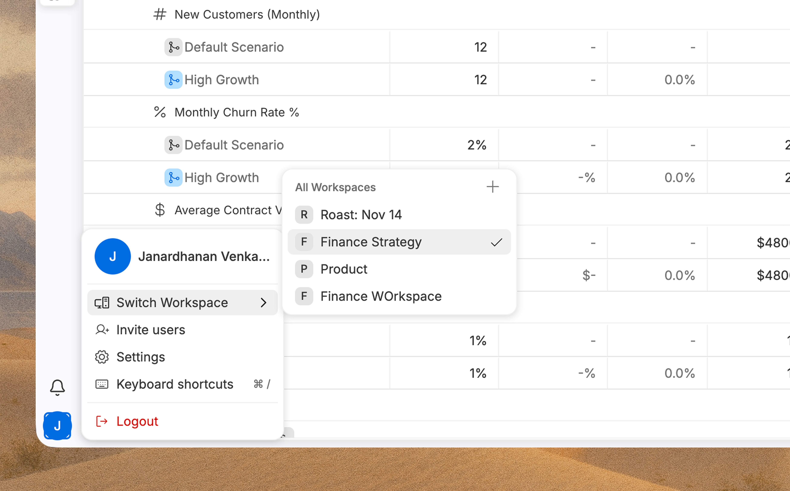

A workspace is the top-level environment where your team uses Oculon. It brings together people, permissions, planning assets, and shared settings so work happens in one governed place.

## What lives in a workspace

A workspace usually includes:

- **People** with workspace-level roles such as **Workspace Owner** and **Member**
- **Spaces** that organize models, Transactions, boards, and related assets (shared teamspaces and a **Private Space**)
- Planning assets such as models, Transactions, views, and boards
- Workspace settings for access, integrations, and organization preferences

## Switching between workspaces

Users often belong to multiple workspaces for different business units, clients, or environments. Switch workspaces from the profile menu.

<Frame caption="Switch workspace">
  
</Frame>

1. Click your **profile icon** in the navigation.
2. Select **Switch Workspace**.
3. Choose the target workspace.

You can also create a new workspace from the workspaces list when your account allows it.

## Why the workspace matters

The workspace determines who can join, what they can see, and how content is organized. If the workspace is set up well, navigation and collaboration both become easier.

## Related pages

- [Workspace access and visibility](/concepts/workspace-and-collaboration/workspace-access-and-visibility)
- [Teamspaces and private space](/concepts/workspace-and-collaboration/teamspaces-and-private-space)
- [Sharing and permissions](/concepts/workspace-and-collaboration/sharing-and-permissions)
- [Users, guests and invitations](/concepts/settings-and-administration/users-guests-and-invitations)
