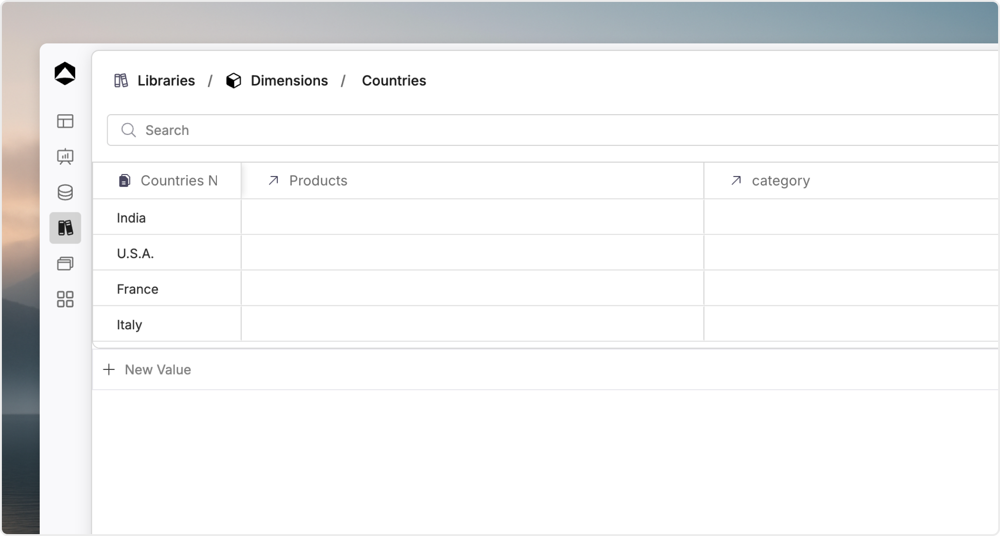

Dimension values are the individual items inside a dimension. If the dimension is `Region`, the values might be `North America`, `EMEA`, and `APAC`.

<Frame caption="Dimension values for a Countries dimension, with related Products and category columns">
  
</Frame>

## What dimension values control

Dimension values determine the detail rows a variable can use. They also shape filters, groupings, and comparisons in views and boards.

## Keep values stable

Use names that will still make sense in six months. If business terminology changes often, agree on a controlled naming approach so formulas and reports stay readable.

## Think about hierarchy

Some dimensions need a flat list. Others need a parent-child structure so values can roll up into a total. Choose the simplest structure that still supports reporting.